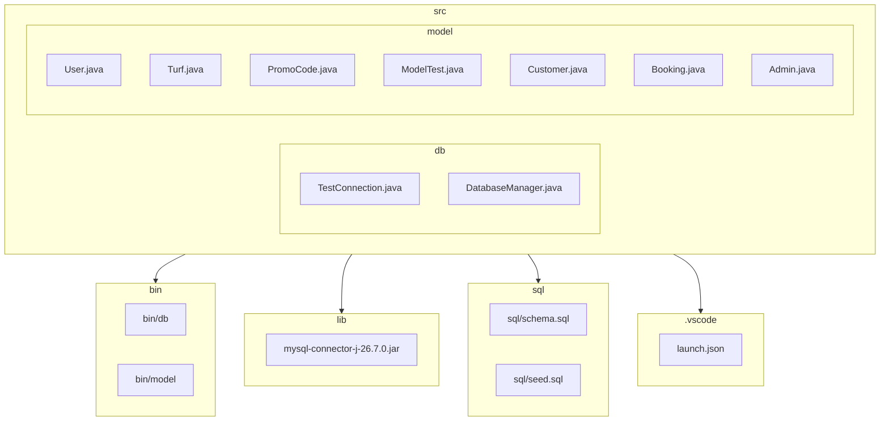

# Project Architecture Diagram

The following diagram shows the high‑level layout of the Turf Management project. It is a **workspace‑level** view, not a detailed class diagram.

- **src/** – source code
  - **db/** – database connection helpers
  - **model/** – domain entities and business logic
- **bin/** – compiled `.class` files
- **lib/** – external JAR dependencies
- **sql/** – database schema and seed data
- **.vscode/** – VS Code launch configuration

Feel free to adjust the diagram if you add more modules or change the structure.
